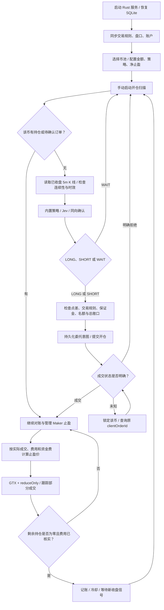

# Genius Trader

Rust 币安 USDT 永续合约交易服务，附本地中文控制台。使用已收盘的 5 分钟 K 线判断做多、做空或等待；每币默认 100 USDT 名义金额，采用 GTX / reduce-only Maker 止盈。按当前需求不设置自动止损、超时强平、自动反手或亏损补仓。

## 启动

需要 Rust 1.89+。辅助脚本优先选择已安装的 rustup 工具链，兼容本机 Homebrew Rust 缺少 LLVM 的情况：

```sh
rtk proxy sh scripts/cargo.sh run --locked
```

打开 http://127.0.0.1:8787。首次默认 **paper 模拟交易，并暂停新增开仓**；以后从 SQLite 恢复已保存的模式和配置，每次启动仍暂停新增开仓。同步币安公共行情后，添加币种、配置参数、启动扫描。

首次依赖安装及公共行情需要网络；离线仍能打开界面，但行情过期时不能启动交易。不会自动使用虚构行情。

首次打开页面会引导设置管理员密码（12–128 个字符，确认两次）。可选择「以游客查看」先查看运行状态；未初始化时所有业务写操作仍被后端拒绝。升级旧数据库时保留现有币池和仓位，并补充管理员初始化。

游客无需密码即可查看运行模式、账户资产、持仓、收益、币池和事件。点击配置、添加/修改币池、启动/暂停或手动平仓时需要管理员验证。登录默认有效 30 分钟；点击右上角「退出管理」立即撤销当前会话，交易运行状态保持不变。

总览的「合约账户资产」展示保证金余额、钱包余额、未实现盈亏、可用余额和初始保证金占用，并提供资产分布、原币余额明细及金额隐藏。测试网 / 实盘读取币安账户汇总：单资产模式以 USDT 显示，联合保证金模式以 USD 显示。资产分布按正钱包余额乘以币安资产 USD 指数计算；缺少或过期的指数不补造估值，保留原币余额并提示占比等待更新。账户资产约每 10 秒独立同步；失败时保留上次数据并标记延迟，不影响订单 / 持仓管理。Paper 展示本机模拟资产，与币安账户资产明确区分。

管理员验证后，在页面点击「配置交易参数」：

- **策略与交易**：金额、净止盈、指标参数、Jev 模型、置信度、杠杆、持仓上限、模拟本金等。
- **账户与连接**：模拟 / 测试网 / 实盘模式、独立的测试网和实盘 API Key / Secret、Jev API Key。
- **系统与管理**：监听端口、管理员会话时长、修改管理员密码。端口修改在下次启动生效；会话时长用于后续登录。修改密码需要再次验证旧密码，修改后其他会话全部失效。

交易、账户、系统配置和管理员记录统一保存在 `data/trader.sqlite`，不读取 `.env` 或配置环境变量，不再使用 config.toml。默认值仅用于首次写入数据库。密钥留空保留已保存值；勾选「清除」才删除。页面和 API 仅返回脱敏状态，密钥不会写入事件或模型行情输入。API 密钥原文保存在本机 SQLite，Unix 上数据库文件权限为 0600。

管理员密码使用随机盐和 Argon2id 哈希，不保存明文，不在日志、API 或页面回显。登录通过 HttpOnly / SameSite=Strict Cookie，数据库仅保存会话令牌的 SHA-256 摘要；会话到期、退出及改密后的旧令牌均无法写入。连续 5 次密码错误后限制登录一分钟，限制状态保存到 SQLite。没有内置默认密码或无密码重置接口，请妥善保管管理员密码。

只有数据库文件位置需要在打开数据库前确定，可通过 `rtk proxy sh scripts/cargo.sh run --locked -- --db data/trader.sqlite` 指定；其余运行配置由页面保存。服务固定监听本机回环地址。

## 已实现

- 合约成交额排序、手动输入、批量添加、启用/停用、删除币种。
- 全局配置与单币覆盖，金额和止盈目标使用十进制字符串。
- EMA、MACD、布林带回归、RSI 回归；通过 `Strategy` trait 和注册表扩展。
- 内置策略、Jev 独立决策、内置策略 + Jev 同向确认。
- SQLite WAL 持久化配置、币池、持仓、订单、信号去重及事件；同一数据库仅允许一个服务实例。
- 订单发送前持久化，状态未知时查询原订单，不盲目重发。
- 止盈按实际数量/均价、手续费、已结算资金费与部分平仓利润反解价格，并按 tick size 取整。
- 暂停/删除币种保留持仓管理；手动平仓使用只减仓市价单。
- 重启恢复持仓与订单，每次启动默认暂停新增开仓。
- 页面配置账户和连接，密钥脱敏、留空保留、显式清除；同一 SQLite 内按交易模式隔离配置、币池、持仓和事件。

## 工作流程



1. `paper` 开仓在盘口买一/卖一模拟成交；`testnet/live` 使用市价开仓，退出挂 Maker 限价单。批量执行通过并发扫描与限速逐笔发送，不要求 50 个币同时成交。
2. 同一根已收盘 K 线最多评估一次。没有新信号、信号过期、币种冷却或额度不足时等待，空仓不会强制开单。
3. 初始最大同时持仓 10 个、总敞口 1,000 USDT。要允许 50 个币各持有约 100 USDT，可将两项配置改为 50 和 5,000，仍需满足实际可用保证金。
4. 数量向下按步长取整，实际名义金额可能少于配置金额。取整后低于交易所最小名义金额则跳过，不自动扩大仓位。
5. 策略、净止盈和杠杆修改只影响后续入场；已有仓位保存自己的净止盈目标和杠杆。模拟本金按差额调整，并保留累计收益。部分成交、资金费结算后重新核算剩余止盈，确认撤单后才替换挂单。
6. 停用、移出币池、暂停扫描均只停止新增入场。订单/持仓管理独立运行；服务重启先查询原委托和真实仓位，再恢复持仓管理。

代码入口：`src/main.rs`；流程编排：`src/engine.rs`；交易所适配：`src/exchange.rs`；策略接口：`src/strategy.rs`；Jev：`src/jev.rs`；本地 API：`src/api.rs`。

## 模式

| 模式 | 行情与成交 |
| --- | --- |
| `paper` | 币安公共行情，本机模拟开仓、Maker 止盈和手续费 |
| `testnet` | `https://demo-fapi.binance.com` 的测试账户订单 |
| `live` | `https://fapi.binance.com` 的真实合约订单 |

在「账户与连接」中填写对应账户密钥并选择模式。实盘还需要勾选「启用实盘交易」，保存后仍需手动启动扫描。测试网和实盘在首次同步账户或检查连接时，先查询持仓模式；发现双向持仓则通过签名 API 自动设置 `dualSidePosition=false`，并再次查询确认。该设置对账户所有合约生效，无需逐币修改；已经是单向持仓时不重复设置。币安因未成交挂单（-4067）或持仓（-4068）拒绝切换时，显示原因并保持新增开仓暂停，由用户处理后重试。切换不会自动撤单或平仓；请求结果不确定时只查询确认，不盲目重发。模式或当前币安账户更换时会暂停扫描，并要求当前无持仓、无待确认订单、无外部账户差异；提前填写其他模式账户不影响当前连接。Jev 密钥可在持仓期间更新，更新后暂停新开仓，已有仓位继续管理。保存为空密钥的测试网配置也能打开页面，但不能启动开仓。

三个模式使用同一 SQLite 内独立的 portfolios 记录，切换回来恢复原来的币池和参数，不混用仓位或交易事件。「检查已保存的连接」检查当前币安公共行情 / 账户访问，并在需要时自动设置单向持仓，不提交交易订单，不调用 Jev。Jev 密钥在实际决策时验证。

当前采用 REST 轮询：盘口目标周期 2 秒，订单/仓位目标周期 5 秒，扫描目标周期 10 秒。网络和节流会影响实际周期；所有入场仅使用已收盘 5 分钟 K 线。持仓管理与 Jev 请求独立运行。尚未接入用户数据 WebSocket，也没有历史回测器。

## Jev

在「账户与连接」保存 Jev API Key，再在「策略与交易」选择 `jev` 或 `hybrid`。使用官方 `POST https://api.typesafe.ai/v1/systemone`；Choice 为 LONG / SHORT / WAIT，验证选项、概率及置信度。超时、异常或低于阈值时等待，不自动降级开单。

默认 `jev-latest` 可改为账户支持的固定版本。置信度不是交易胜率。记录输入、配置、结构化输出、实际模型版本和 token 用量；模型费用尚未自动换算为 USDT。

## 当前边界

- 模拟 Maker 成交要求挂单后的新报价严格穿过限价，按盘口数量限制成交；触价不算成交。模拟不建模撮合队列、强平和资金费。
- 实盘资金费读取账户 income；手续费暂只支持 USDT。BNB 等其他资产手续费保持待结算并告警，不虚构兑换收益。
- 非本系统订单、外部持仓或数量差异会暂停新增开仓并标记，保留外部订单，需人工核对。
- 未知订单保留锁定。超过交易所历史查询保留期、单订单 1,000 笔成交查询上限，需要人工核对。
- 净止盈是计算目标，实际滑点、资金费与收费变化可能造成偏差。
- Ctrl+C 停止服务，交易所已有挂单保留；服务停止期间不再追踪撤单及费用变化。

## API

写请求需要 `X-Genius-Request: 1`，拒绝浏览器跨源写请求及非 localhost / 127.0.0.1 的 Host。服务只绑定本机回环地址。
所有业务写请求还需要有效的管理员会话 Cookie；未登录返回 401。仅初始化、登录和退出端点不要求已有会话。初始化仅在管理员记录不存在时成功，并以数据库唯一约束防止重复初始化。

| 方法 | 路径 | 内容 |
| --- | --- | --- |
| GET | `/api/state` | 配置、币池、持仓、订单、收益、健康状态、account_assets 及其同步时间 / 错误状态 |
| GET | `/api/markets` | 可交易币对，按成交额降序 |
| GET | `/api/events` | 最近 100 条事件及决策输入 |
| GET | `/api/auth/status` | 是否初始化、当前请求是否登录、到期时间 |
| POST | `/api/auth/setup` | 首次设置管理员密码：password / confirm_password |
| POST | `/api/auth/login` | 管理员密码登录：password |
| POST | `/api/auth/logout` | 撤销当前会话、清除 Cookie |
| POST | `/api/auth/password` | 修改密码：current_password / password / confirm_password |
| GET / PUT | `/api/server` | SQLite 中的 port / session_minutes |
| PUT | `/api/config` | 完整配置 JSON |
| GET | `/api/settings` | 当前模式、启用状态、密钥脱敏状态 |
| PUT | `/api/settings` | 保存模式和账户连接配置；返回脱敏状态 |
| POST | `/api/settings/check` | 检查已保存的币安连接，并在需要时自动设置单向持仓 |
| POST | `/api/pool` | `{symbol, enabled, config}` |
| DELETE | `/api/pool/{symbol}` | 移出候选池，保留持仓管理 |
| POST | `/api/control` | `{running: true/false}` |
| POST | `/api/positions/{symbol}/close` | 手动平仓 |
| POST | `/api/markets/refresh` | 更新规则与排名 |

单币 `config` 字段：`notional_usdt`、`profit_usdt`、`strategy`、`decision_mode`、`allowed_direction`；未覆盖字段为 null。时间为 Unix 毫秒。

连接设置支持部分更新，例如 `{ "mode": "testnet", "testnet": { "key": "...", "secret": "..." }, "jev_key": "..." }`。空字符串 / 省略密钥字段表示保留，`testnet.clear`、`live.clear`、`clear_jev` 表示显式清除。实盘模式需要 `live_enabled: true`。

## 验证

```sh
rtk proxy sh scripts/cargo.sh fmt --check
rtk proxy sh scripts/cargo.sh test --locked
rtk proxy sh scripts/cargo.sh clippy --locked --all-targets -- -D warnings
```

测试不需要真实账户，不提交测试网或实盘订单。

部分测试会启动回环地址上的模拟 HTTP 服务，需要本机监听权限。已覆盖多空部分止盈、触价不成交、重复报价、暂停/删除仍管理、同根 K 线去重、重启后未知订单恢复、重复回报、USDT 费用结算、跨模式数据库隔离、Jev 结构与阈值验证。真实 Jev 账户调用和币安测试网/实盘成交仍需配置各自密钥后验证。

旧版单模式 state 表自动迁移；默认数据库首次导入旧版 data/paper.sqlite、testnet.sqlite、live.sqlite，或之前预览使用的 preview-paper.sqlite，不覆盖已存在的对应模式记录，原文件保留。旧环境变量和 .env 不再生效，API 密钥需要在页面重新填写。管理员密码未初始化的旧数据库会显示首次设置引导，不自动生成默认密码。

管理员密码哈希实现依据：[RustCrypto Argon2 0.5.3](https://docs.rs/argon2/0.5.3/argon2/)。

接口依据：[Binance USD-M](https://developers.binance.com/docs/derivatives/usds-margined-futures/general-info)、[TypeSafe Jev](https://docs.typesafe.ai/api)。
