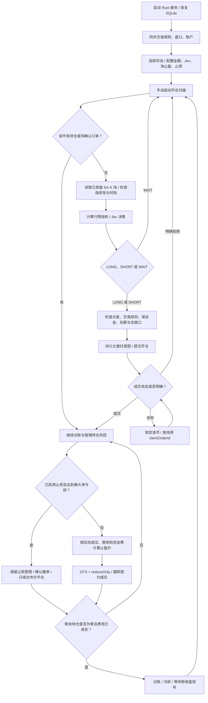

# Genius Trader

Rust 币安 USDT / USDC 永续合约交易服务，附本地中文控制台。使用已收盘的 5 分钟 K 线判断做多、做空或等待；每币默认 100 计价币（USDT 或 USDC）名义金额，采用 GTX / reduce-only Maker 止盈。支持按每笔最大净亏损金额配置本地自动止损，默认关闭。不设置超时强平、自动反手或亏损补仓。

## 启动

需要 Rust 1.89+。辅助脚本优先选择已安装的 rustup 工具链，兼容本机 Homebrew Rust 缺少 LLVM 的情况：

```sh
rtk proxy sh scripts/cargo.sh run --locked
```

打开 http://127.0.0.1:8787。首次默认 **paper 模拟交易，并暂停新增开仓**；以后从 SQLite 恢复已保存的模式和配置，每次启动仍暂停新增开仓。同步币安公共行情后，添加币种、配置参数、启动扫描。

首次依赖安装及公共行情需要网络；离线仍能打开界面，但行情过期时不能启动交易。不会自动使用虚构行情。

首次打开页面会引导设置管理员密码（12–128 个字符，确认两次）。可选择「以游客查看」先查看运行状态；未初始化时所有业务写操作仍被后端拒绝。升级旧数据库时保留现有币池和仓位，并补充管理员初始化。

游客无需密码即可查看运行模式、账户资产、持仓、收益、币池和事件。点击配置、添加/修改币池、启动/暂停或手动平仓时需要管理员验证。登录默认有效 30 分钟；点击右上角「退出管理」立即撤销当前会话，交易运行状态保持不变。

总览的「合约账户资产」展示保证金余额、钱包余额、未实现盈亏、可用余额和初始保证金占用，并提供资产分布、原币余额明细及金额隐藏。测试网 / 实盘读取币安账户汇总：单资产模式以 USDT 显示，联合保证金模式以 USD 显示。资产分布按正钱包余额乘以币安资产 USD 指数计算；缺少或过期的指数不补造估值，保留原币余额并提示占比等待更新。账户资产约每 10 秒独立同步；失败时保留上次数据并标记延迟，不影响订单 / 持仓管理。Paper 展示本机模拟资产，与币安账户资产明确区分。

控制台以「我的自选」卡片展示币对，支持搜索以及全部 / 有持仓 / 有挂单 / 已停用筛选。每张卡片汇总盘口中间价、报价状态、持仓方向 / 杠杆 / 数量 / 均价 / 浮盈亏 / 止盈价 / 最大净亏损、挂单角色 / 买卖方向 / 剩余数量，以及最近决策的方向、置信度、模型与时间。缺失报价显示「—」，过期报价标记待更新。移出自选的持仓与委托仍显示在独立的持仓、挂单面板中。

「最近决策」展示当前模式最近 30 次评估，展开可查看概率、指标、K 线收盘时间和模型用量。决策摘要从 SQLite 恢复，不受最近事件条数或服务重启影响；自动刷新保留已展开的详情。决策方向表示模型评估，不代表已经成交。外部持仓或挂单差异会单独提示。

管理员验证后，在页面点击「配置交易参数」：

- **策略与交易**：金额、净止盈、最大净亏损、指标参数、Jev 模型、置信度、杠杆、持仓上限、模拟本金等。
- **账户与连接**：模拟 / 测试网 / 实盘模式、独立的测试网和实盘 API Key / Secret、Jev API Key。
- **系统与管理**：监听端口、管理员会话时长、修改管理员密码。端口修改在下次启动生效；会话时长用于后续登录。修改密码需要再次验证旧密码，修改后其他会话全部失效。

交易、账户、系统配置和管理员记录统一保存在 `data/trader.sqlite`，不读取 `.env` 或配置环境变量，不再使用 config.toml。默认值仅用于首次写入数据库。密钥留空保留已保存值；勾选「清除」才删除。页面和 API 仅返回脱敏状态，密钥不会写入事件或模型行情输入。API 密钥原文保存在本机 SQLite，Unix 上数据库文件权限为 0600。

管理员密码使用随机盐和 Argon2id 哈希，不保存明文，不在日志、API 或页面回显。登录通过 HttpOnly / SameSite=Strict Cookie，数据库仅保存会话令牌的 SHA-256 摘要；会话到期、退出及改密后的旧令牌均无法写入。连续 5 次密码错误后限制登录一分钟，限制状态保存到 SQLite。没有内置默认密码或无密码重置接口，请妥善保管管理员密码。

数据库文件位置和监听地址需要在启动时确定，可通过 `rtk proxy sh scripts/cargo.sh run --locked -- --db data/trader.sqlite --bind 127.0.0.1` 指定；其余运行配置由页面保存。默认监听本机回环地址。

## GitHub Packages 容器

镜像：`ghcr.io/zuoban/geniustrader:0.1.4`，同时支持 Linux AMD64 和 ARM64；`latest` 指向最近一次发布。镜像为公开包，可匿名拉取，无需 GitHub 账号、PAT 或 `docker login`。

```sh
rtk proxy docker pull ghcr.io/zuoban/geniustrader:0.1.4
rtk proxy docker run -d --name genius-trader \
  --publish 8787:8787 \
  --mount type=volume,source=genius-trader-data,target=/app/data \
  ghcr.io/zuoban/geniustrader:0.1.4
```

本机打开 http://127.0.0.1:8787，服务器部署则打开 `http://服务器IPv4:8787`，首次仍为暂停的 paper 模式，并要求设置管理员密码。容器以 UID/GID 10001 运行，SQLite 和密钥持久化在数据卷；重建容器时保留同一个卷。宿主机的 8787 端口需要可用。数据库中的端口若改为其他值，下次启动时需同步修改端口映射。

容器内通过 `--bind 0.0.0.0` 接收映射流量，允许 localhost、127.0.0.1 和 IPv4 Host；API 继续校验来源及管理员会话。服务器防火墙和云安全组需允许客户端访问 TCP 8787，建议仅放行你的客户端 IP。若只需本机或 SSH 隧道访问，将端口映射改为 `127.0.0.1:8787:8787`。`docker stop genius-trader` 会发送 SIGINT 并正常停止服务。

本地构建与验证：

```sh
rtk proxy docker build --tag genius-trader:local .
rtk proxy python3 scripts/smoke-container.py genius-trader:local
```

构建上下文只包含源码、嵌入式网页和 Cargo 清单，不包含本机数据库、密钥或构建产物。构建阶段执行锁定依赖的 Rust 测试；容器验证使用独立临时数据卷，检查界面、API、非 root 数据库权限、正常停止及重启持久化。

GitHub Actions 的「Publish GitHub Package」可手动执行，也会在推送 `v*` 标签时触发（标签版本须与 Cargo.toml 一致）。两个架构分别构建、测试并验证容器，再发布版本、`latest` 和提交 SHA 标签；发布使用仓库自带的 `GITHUB_TOKEN`，无需保存额外发布密钥。

工作流验证镜像清单中的两个架构、仓库来源及包的公开状态，并检查版本和 `latest` 标签可以匿名拉取。GitHub 若未自动关联仓库，会在发布摘要中提示；可登录[包页面](https://github.com/users/zuoban/packages/container/package/geniustrader)，点击「Connect repository」并选择 `zuoban/GeniusTrader`，以展示仓库链接和 README。

## Docker Compose 部署

使用 Docker Compose v2 或更新版本，在 `compose.yaml` 所在目录执行。以下命令带 `rtk proxy`；服务器未安装 RTK 时去掉此前缀即可。

```sh
rtk proxy docker volume create genius-trader-data
rtk proxy docker compose pull
rtk proxy docker compose up -d
rtk proxy docker compose ps
```

`compose.yaml` 使用已发布的 `0.1.4` 公开镜像，通过 `8787:8787` 映射宿主机端口，支持 `http://服务器IPv4:8787` 访问。数据库保存在外部数据卷 `genius-trader-data`；该卷先创建一次，以后重建或停止 Compose 项目时继续保留。之前通过 `docker run` 使用同名卷时可直接复用，但切换部署方式前需要停止使用该数据库的旧容器，避免同一数据库运行两个实例。

打开 `http://服务器IPv4:8787`（本机部署使用 http://127.0.0.1:8787），首次设置管理员密码并在页面配置账户。首次默认 paper 模式并暂停新增开仓；每次重启仍暂停新增开仓。若宿主机 8787 端口被占用，将 `ports` 改成 `"8877:8787"`，再访问 `http://服务器IPv4:8877`；容器端口仍为 8787。

从 `0.1.0` 升级时，必须同时更新镜像版本和端口映射：旧版本只接受 localhost / 127.0.0.1 Host，旧的 `127.0.0.1:8787:8787` 映射也只能在服务器本机访问。更新后执行 `rtk proxy docker compose pull` 和 `rtk proxy docker compose up -d`，保留现有数据卷。

查看日志和停止服务：

```sh
rtk proxy docker compose logs --tail 100 -f trader
rtk proxy docker compose down
```

若使用 SSH 隧道，将端口映射设为 `"127.0.0.1:8787:8787"`，在本机执行 `rtk proxy ssh -N -L 8877:127.0.0.1:8787 用户名@服务器IP`，然后打开 http://127.0.0.1:8877。API 密钥和交易配置由页面保存到 SQLite。

IP 访问失败时先看 `rtk proxy docker compose ps` 的端口：应显示 `0.0.0.0:8787->8787/tcp`；若仅显示 `127.0.0.1:8787`，端口仍只允许本机访问。服务器本机 `rtk proxy curl http://127.0.0.1:8787/api/auth/status` 成功、远程连接超时通常需要检查防火墙 / 云安全组；收到 HTTP 403 则检查是否仍使用旧镜像或覆盖了容器的 `--bind 0.0.0.0` 启动参数。

「持仓管理异常」显示「未收到 HTTP 响应」时，表示尚未收到币安 HTTP 状态码，不能据此认定 API Key 或权限错误。日志会进一步区分域名解析、TLS、连接拒绝、连接中断和超时。宿主机 `curl` 成功不能验证容器的 DNS、出口和代理配置；先分别检查：

```sh
rtk proxy curl --silent --show-error --max-time 10 https://fapi.binance.com/fapi/v1/time
rtk proxy docker compose exec -T trader getent ahosts fapi.binance.com
rtk proxy docker compose exec -T trader cat /etc/resolv.conf
```

测试网将域名换成 `demo-fapi.binance.com`。镜像不包含 curl；`getent` 只验证容器域名解析，不代表 HTTPS 已连通。宿主机解析正常、容器解析失败时，检查 Docker DNS 和到 DNS 服务器的访问；TLS 错误检查宿主机时间、证书和代理链路；连接被拒绝则检查代理是否运行以及容器是否能访问其地址和端口。

reqwest 会读取进程的 `HTTP_PROXY` / `HTTPS_PROXY` / `ALL_PROXY` / `NO_PROXY`（也支持小写），宿主机终端中的代理变量不会自动传入容器。需要代理时在 Compose 的 `trader.environment` 中显式配置；容器中的 `127.0.0.1` 指向容器自身，不能直接用于访问宿主机代理。排查时只检查变量是否存在，避免输出含认证信息的代理 URL：

```sh
rtk proxy docker compose exec -T trader sh -c '
for name in HTTP_PROXY HTTPS_PROXY ALL_PROXY NO_PROXY http_proxy https_proxy all_proxy no_proxy; do
  if printenv "$name" >/dev/null; then
    printf "%s=set\n" "$name"
  else
    printf "%s=unset\n" "$name"
  fi
done'
```

升级时修改 `compose.yaml` 中的镜像版本，再执行 `rtk proxy docker compose pull` 和 `rtk proxy docker compose up -d`，复用原数据卷。

## 已实现

- USDT / USDC 永续合约成交额排序、手动输入（BTCUSDC 或 BTC/USDC）、批量添加、启用/停用、删除币种。
- 全局配置与单币覆盖，金额和止盈目标使用十进制字符串。
- 仅使用 Jev 决策做多、做空或等待；EMA、MACD、RSI、布林带统一作为行情输入，支持配置指标参数。
- SQLite WAL 持久化配置、币池、持仓、订单、信号去重及事件；同一数据库仅允许一个服务实例。
- 订单发送前持久化，状态未知时查询原订单，不盲目重发。
- 止盈按实际数量/均价、手续费、已结算资金费与部分平仓利润反解价格，并按 tick size 取整。
- 按每笔最大净亏损触发本地止损，计入已记录的手续费、资金费、部分平仓盈亏和预估 Taker 平仓费；确认撤单后只减仓市价平仓。
- 暂停/删除币种保留止盈与止损管理；手动平仓使用只减仓市价单。
- 重启恢复持仓与订单，每次启动默认暂停新增开仓。
- 页面配置账户和连接，密钥脱敏、留空保留、显式清除；同一 SQLite 内按交易模式隔离配置、币池、持仓和事件。

## 工作流程



1. `paper` 开仓在盘口买一/卖一模拟成交；`testnet/live` 使用市价开仓，退出挂 Maker 限价单。批量执行通过并发扫描与限速逐笔发送，不要求 50 个币同时成交。
2. 同一根已收盘 K 线最多评估一次。没有新信号、信号过期、币种冷却或额度不足时等待，空仓不会强制开单。
3. 初始最大同时持仓 10 个、总敞口 1,000 USDT。要允许 50 个币各持有约 100 USDT，可将两项配置改为 50 和 5,000，仍需满足实际可用保证金。
4. 数量向下按步长取整，实际名义金额可能少于配置金额。取整后低于交易所最小名义金额则跳过，不自动扩大仓位。
5. 策略、净止盈和杠杆修改只影响后续入场；已有仓位保存自己的净止盈目标和杠杆。模拟本金按差额调整，并保留累计收益。部分成交、资金费结算后重新核算剩余止盈，确认撤单后才替换挂单。
6. 停用、移出币池、暂停扫描均只停止新增入场。订单/持仓管理独立运行；服务重启先查询原委托和真实仓位，再恢复持仓管理。

代码入口：`src/main.rs`；流程编排：`src/engine.rs`；交易所适配：`src/exchange.rs`；行情指标与决策结构：`src/strategy.rs`；Jev：`src/jev.rs`；本地 API：`src/api.rs`。

## 模式

| 模式 | 行情与成交 |
| --- | --- |
| `paper` | 币安公共行情，本机模拟开仓、Maker 止盈和手续费 |
| `testnet` | `https://demo-fapi.binance.com` 的测试账户订单 |
| `live` | `https://fapi.binance.com` 的真实合约订单 |

在「账户与连接」中填写对应账户密钥并选择模式。实盘还需要勾选「启用实盘交易」，保存后仍需手动启动扫描。测试网和实盘在首次同步账户或检查连接时，先查询持仓模式；发现双向持仓则通过签名 API 自动设置 `dualSidePosition=false`，并再次查询确认。该设置对账户所有合约生效，无需逐币修改；已经是单向持仓时不重复设置。币安因未成交挂单（-4067）或持仓（-4068）拒绝切换时，显示原因并保持新增开仓暂停，由用户处理后重试。切换不会自动撤单或平仓；请求结果不确定时只查询确认，不盲目重发。模式或当前币安账户更换时会暂停扫描，并要求当前无持仓、无待确认订单、无外部账户差异；提前填写其他模式账户不影响当前连接。Jev 密钥可在持仓期间更新，更新后暂停新开仓，已有仓位继续管理。保存为空密钥的测试网配置也能打开页面，但不能启动开仓。

三个模式使用同一 SQLite 内独立的 portfolios 记录，切换回来恢复原来的币池和参数，不混用仓位或交易事件。「检查已保存的连接」检查当前币安公共行情 / 账户访问，并在需要时自动设置单向持仓，不提交交易订单，不调用 Jev。Jev 密钥可通过独立的「测试连接」验证。

测试网和实盘账户各提供「测试连接」按钮，可在任意交易模式下独立验证对应账户。留空使用已保存的密钥；填写新值时与保留值合并后测试，首次配置必须同时填写 Key / Secret。测试先同步币安时间，再通过 [只读签名账户接口](https://developers.binance.com/en/docs/catalog/core-trading-derivatives-trading-usd-s-m-futures/api/rest-api/account#account-information-v2-user_data) 验证密钥，显示成功、账户交易状态或中文错误原因（签名错误、Key / 权限 / IP 限制、网络异常等）。测试不会保存输入、切换当前模式、修改持仓模式或提交订单；测试通过后仍需点击保存。账户 `canTrade` 状态不代表 API 下单权限已经验证。

在「策略与交易 → 仓位与风控」设置 **最大净亏损 / 计价币**（API 字段 `stop_loss_usdt`，沿用历史金额字段命名）。USDT 合约以 USDT、USDC 合约以 USDC 配置；全局默认 `0` 关闭。单币配置留空（API 为 `null` 或省略）继承全局，填 `0` 单独关闭，负数被拒绝。开仓委托保存当时的止损金额和费率，成交后成为该笔持仓的设置；修改配置仅影响后续新开仓。升级前的持仓继续保持止损关闭。

止损检查按多仓买一、空仓卖一计算：`预估交易净收益 = 已实现毛收益 − 已记录开仓费 − 已记录平仓费 − 已记录资金费 + 剩余数量 × 方向 × (盘口平仓价 − 开仓均价) − 剩余数量 × 盘口平仓价 × 入场时 Taker 费率`。预估净收益小于等于最大净亏损的负值时触发；部分平仓利润和收到的资金费也计入。触发状态先写入 SQLite，然后确认撤销本系统已有委托，以剩余实际持仓量提交只减仓市价平仓；触发后即使价格反弹或服务重启，仍继续处理原止损意图。撤单未确认、已有平仓委托或订单状态未知时继续查询，避免重复下单。资金费接口单独失败时暂停新增开仓，持仓风控继续使用已记录资金费；未同步费用可能使预估出现偏差。

这是由本地服务轮询执行的止损，服务停止期间不执行，交易所没有预挂止损单。只使用距更新小于 15 秒的有效盘口；持仓检查目标周期约 5 秒，实际周期受请求和节流影响。滑点、网络延迟、未知订单或账户差异可能推迟平仓并使实际亏损超过配置金额；该金额是触发阈值。

当前采用 REST 轮询：盘口目标周期 2 秒，订单/仓位目标周期 5 秒，扫描目标周期 10 秒。网络和节流会影响实际周期；所有入场仅使用已收盘 5 分钟 K 线。持仓管理与 Jev 请求独立运行。尚未接入用户数据 WebSocket，也没有历史回测器。

订单对账最多并发 4 个只读状态查询，回报仍按原委托顺序入账，部分开仓的撤单和成交结算顺序保留；单个查询失败时继续保留原订单并锁定该币对。仓位、未成交订单与保证金余额并发读取，三项都成功后才一次性更新账户快照。发送仍受同一域名的 100 毫秒间隔限制，慢请求仍可能延长持仓管理周期；时间同步在取得发送名额后开始计时，排队等待不计入交易所时差。

依据币安 [IP 限流与退避规则](https://developers.binance.com/en/docs/products/derivatives-trading-usds-futures/general-info#ip-limits)，进程内同一币安域名的客户端共享限速、权重预算和退避状态，更换密钥、切换引擎或测试连接不会清除该状态。HTTP 429 / 418 收到响应头即触发退避；JSON 错误码 -1003 / -1015 也会触发。有效 `Retry-After` 支持秒数或 HTTP 日期（最长 3 天），无有效值时 429 / 错误码从 60 秒、418 从 120 秒起指数增加，分别最多 15 分钟 / 3 天；同一批在途响应不重复增加退避级别，退避结束后 30 分钟未再限流才重置级别。退避期间后续请求立即返回「本次未发送」及剩余等待时间，避免持锁等待整个封禁期；已在途请求仍按原有结果确认逻辑处理。到期后后续查询可继续，新增开仓仍遵循原暂停与手动启动流程。该状态不跨进程共享，重启后重置。

请求预算按当前使用的 [USD-M 行情](https://developers.binance.com/en/docs/catalog/core-trading-derivatives-trading-usd-s-m-futures/api/rest-api/market-data)、[账户](https://developers.binance.com/en/docs/catalog/core-trading-derivatives-trading-usd-s-m-futures/api/rest-api/account)和[交易接口](https://developers.binance.com/en/docs/catalog/core-trading-derivatives-trading-usd-s-m-futures/api/rest-api/trade)的权重计算，区分单币 / 全市场查询和 K 线 `limit` 档位。默认一分钟权重上限 2400，成功读取 `exchangeInfo` 时用有效的 `REQUEST_WEIGHT / MINUTE / 1` 规则更新。普通请求最多使用上限的 90%；账户 / 持仓核对、订单查询、成交结算和撤单可使用剩余保留额度，标记 `reduceOnly=true` 的平仓按文档使用 0 IP 权重，但仍受请求间隔和服务端限流退避约束。额度不足立即返回「本次未发送」，不等待整个窗口，也不自动重发订单。

预算使用单调时钟维护最近 60 秒的本地请求权重，并合并有效的 `X-MBX-USED-WEIGHT-1M` 响应头；服务端报告也保留 60 秒，较低或乱序的报告不能清除本地在途请求与尚未过期的高报告。该估计比服务端按分钟清零更保守，分钟切换后可能延后恢复；bookTicker 的权重响应头按官方说明忽略。其他进程和共享出口的新增消耗只能在后续响应头中观察；账户订单次数配额继续依靠请求间隔和 429 / -1015 退避，未单独实现订单次数预算。

`/api/state` 和 `/api/dashboard` 的 `exchange_rate_limit` 暴露同域名共享的预算状态：一分钟上限 `weight_limit`、普通请求上限 `regular_weight_limit`、保守估计用量 `estimated_used_weight`、总 / 普通剩余额度 `remaining_weight` / `regular_remaining_weight`、最近有效服务端报告 `server_reported_used_weight`、下一笔计数释放的毫秒数 `next_weight_release_in_ms`、剩余退避毫秒数 `cooldown_remaining_ms`、上次限流的 HTTP 状态 / 错误码，以及累计已放行、预算拒绝、退避拒绝、服务端限流响应次数。下一笔计数释放不代表所有请求都能立即恢复；服务端报告过期后为 null。统计只包含数值与固定原因，不包含密钥、签名或请求参数。

币池扫描保持最多 4 个候选并发，按上次实际派发的币对轮转起点；已评估当前 K 线、冷却中、停用和已占用的币对提前过滤。排队期间再次检查信号窗口、行情 / 账户时效、配置版本及额度；窗口耗尽后不再派发剩余候选，下一根 K 线从未服务的币对继续轮转。已在途的请求仍执行原有超时与提交前风控检查；大币池不保证每根 K 线评估全部币对。轮转游标保存在内存，重启或切换引擎后重新开始。

盘口的 `time` 为本地接收时间，用于 15 秒轮询时效检查；`exchange_time` 保留币安 [bookTicker 的交易所交易时间](https://developers.binance.com/en/docs/catalog/core-trading-derivatives-trading-usd-s-m-futures/api/rest-api/market-data#symbol-order-book-ticker)。交易所时间倒退的快照不替换价格，也不更新该币对的本地接收时间；相同交易所时间的成功响应可确认连接仍在更新。模拟止盈另行持久化已使用的交易所时间，重复响应不会重新提供同一份盘口数量，重启后继续去重；旧账本首次观察带交易所时间的盘口时先建立基线，等待后续时间推进再撮合。

控制台的币池最新决策通过一次 SQL 查询取回，并保留按币对索引查找最新记录；未变化的列表和资产区域跳过 DOM 替换，保留展开详情与焦点。页面隐藏时停止定时请求，重新显示时立即刷新。状态和事件查询 10 秒超时后允许下一轮刷新；写操作最多等待 45 秒，超时提示核对执行结果，不自动重复操作。

`/api/state` 和 `/api/dashboard` 的 `runtime.scan` / `runtime.position_management` 提供运行监控：`running`、完成轮次 `runs`、异常轮次 `failed_runs`、超出目标间隔的轮次 `slow_runs`、最近开始 / 完成时间、最近 / 最大耗时 `last_duration_ms` / `max_duration_ms`、相邻两次实际开始间隔 `last_start_interval_ms`。耗时和间隔使用单调时钟，时间标签为 Unix 毫秒；持仓管理耗时包含等待对账锁及网络请求。扫描计数包含暂停或无候选时的空轮询；扫描中任何候选返回等待错误（含风控拒绝）会计入该轮 `failed_runs`，不等同于系统故障。完成一轮扫描超过 10 秒或持仓管理超过 5 秒时输出中文警告日志。这些统计不写入交易账本，服务重启或切换引擎后重新计数。

空轮询、没有模拟成交及未变化的非终态订单回报会跳过账本保存；其他相同快照保存也不会更新数据库记录。落库失败保留待保存标记，后续空轮询仍重试；委托意图继续在发送前同步保存。Jev 决策请求只在取得客户端时短暂持锁，更换密钥无需等待旧请求结束；更换后暂停新增开仓，并通过配置版本检查阻止旧决策开仓。

币安请求单次总超时为 8 秒；HTTP 200 仍可能发生响应读取超时或 JSON 解析异常，错误记录会显示具体接口及失败阶段。公开行情和签名只读 GET（持仓、余额、账户、订单状态等）遇到瞬时连接/读取失败、空响应或不完整 JSON 时，间隔 250 毫秒最多重试一次；签名重试重新生成时间戳与签名，避免沿用过期请求。HTTP 拒绝、TLS 错误和无效 JSON 直接报告。时间同步保持单次请求，确保时差估计不包含失败尝试；订单发送和撤单也保持单次请求，执行结果不确定时继续查询确认。重试后仍无法同步行情或持仓时暂停新增开仓，行情与账户过期检查继续生效；持续网络故障仍需修复服务器或容器连接。

入场前和提交订单前检查盘口：距上次更新必须小于 15 秒，买卖点差不得超过配置的「点差上限 / bps」。1 bps = 0.01%，默认 10 bps = 0.1%；点差按 `(卖一价 − 买一价) / 中间价 × 10000` 计算。触发时本轮等待，日志分别显示「盘口过期」或「点差过大」，并在 `quote_check` 中保存当时的原始盘口、盘口年龄、实际点差及限制。

## Jev

决策模式固定为 `jev`。在「账户与连接」保存 Jev API Key，再在「策略与交易」配置模型、最低置信度、回看长度和判断窗口；模拟 / 测试网 / 实盘启动扫描都需要 Jev 密钥。EMA、MACD、RSI 和布林带同时提供给模型，仅作为行情输入，不独立产生开仓信号。使用官方 `POST https://api.typesafe.ai/v1/systemone`；Choice 为 LONG / SHORT / WAIT，验证选项、概率及置信度。超时、异常或低于阈值时等待，不自动降级开单。

入场按判断窗口内扣除点差、开仓 Taker 和退出 Maker 手续费后的方向优势评估，允许部分指标分歧和幅度较小但足以覆盖费用的机会。`profit_usdt` 是持仓退出的净止盈目标，不再要求模型预测在判断窗口内达到完整目标；判断窗口也不触发自动平仓。默认最低置信度从 0.70 调整为 0.55；已有 SQLite 配置保留原阈值与超时。在「策略与交易 → TypeSafe AI · Jev」点击「填入推荐参数」，会将表单置信度改为 0.55、低于 15 秒的超时提高到 15 秒，保存后才生效。仍由 Jev 选择 LONG / SHORT / WAIT，不将模型 WAIT 转换成开仓；点差、行情时效、保证金、名额和总敞口检查继续生效。实际交易频率和盈亏需要行情验证。

决策日志新增 `model_action`（模型原始选择）和 `reason`（本地筛选说明）；页面显示模型选择等待的概率分布，或模型选择开仓但置信度低于门槛的具体数值。说明来自结构化输出与本地门槛，不是模型生成的市场分析。旧决策没有这些字段时仍可读取。

旧 SQLite 全局和单币配置中的 `builtin` / `hybrid` 兼容读取为 `jev`，下次保存时写回 `jev`；旧 `strategy.kind` 兼容读取后忽略，保存时移除。指标周期、金额、净止盈、币池和持仓数据继续保留。每次启动仍暂停新增开仓，配置 Jev 后手动启动扫描。

Jev 请求使用紧凑行情表降低输入消耗：[官方 `state` 格式](https://docs.typesafe.ai/concepts/state)允许结构化 JSON 和文本。完整回看行情按从旧到新排列，OHLCV 以单个 CSV 表头和数据行传入；起始开盘时间、5 分钟间隔和收盘偏移只传一次。第 i 行的开盘时间为 `first_open_time_ms + i × interval_ms`（i 从 0 开始），收盘时间再加 `close_offset_ms`。不裁剪 K 线、不降低价格或成交量精度；压缩前校验连续性和收盘状态。提示词包含费用、点差、净止盈的退出用途及没有扣费后方向优势时等待的要求。本地 120 / 500 根、高低价样本请求体大小由紧凑请求测试验证；字节缩减不等于实际 token 缩减，实际以返回的 `usage` 为准。原始行情继续保存在本地决策日志。

概率总和按[官方 SDK 的「近似 1」约定](https://docs.typesafe.ai/sdk/python/api/types/responses)校验：兼容三项概率保留两位小数后的总和 0.99–1.01（包含端点），记录保留原始值。各项仍必须是 0–1 的有限数，选项必须完整且 choice 为最高概率选项（允许并列）；超出容差时等待，并在错误中显示 LONG / SHORT / WAIT 数值及总和，便于区分舍入误差与真正异常。

Jev 密钥配置提供「测试连接」：填写时测试当前输入，留空时使用已保存的密钥，勾选清除时需先取消清除才能测试。通过官方 [模型列表接口](https://docs.typesafe.ai/models) `GET https://api.typesafe.ai/v1/models` 验证密钥、网络和账户模型访问，显示成功或中文错误原因；10 秒超时。测试不保存密钥、不影响正在运行的交易，也不调用决策模型或触发模型推理计费；通过后仍需保存新密钥。实际决策时继续验证模型调用。

默认 `jev-latest` 可改为账户支持的固定版本。决策请求默认总超时为 15 秒，包含建立连接、上传行情和读取结果；已有 SQLite 配置保留原来的值，可在「策略与交易 → TypeSafe AI · Jev」调整（1–30 秒）。「测试连接」成功说明模型列表可访问，不代表决策接口的模型处理一定能在配置的时限内完成。错误记录区分超时、DNS、TLS、连接中断与 HTTP 状态，错误时本轮等待；不自动重试可能已计费的决策请求。置信度不是交易胜率。记录输入、配置、结构化输出、实际模型版本和服务返回的 `input_tokens` / `output_tokens`，以及实际请求的 `request_bytes`；服务未返回的用量字段记为 0，模型费用尚未自动换算为 USDT。

## 当前边界

- 模拟 Maker 成交要求挂单后的新报价严格穿过限价，按盘口数量限制成交；触价不算成交。模拟不建模撮合队列、强平和资金费。
- 实盘手续费与资金费按合约结算币种（USDT / USDC）记账；其他资产手续费（如 BNB）或结算币种不匹配时保持待结算并告警，不虚构兑换收益。
- 非本系统订单、外部持仓或数量差异会暂停新增开仓并标记，保留外部订单，需人工核对。
- 未知订单保留锁定。超过交易所历史查询保留期、单订单 1,000 笔成交查询上限，需要人工核对。
- 净止盈和止损金额均是计算目标，实际滑点、资金费与收费变化可能造成偏差；本地止损需要服务持续运行。
- Ctrl+C 停止服务，交易所已有挂单保留；服务停止期间不再追踪撤单及费用变化。

## API

写请求需要 `X-Genius-Request: 1`，拒绝浏览器跨源写请求。服务默认绑定本机回环地址，仅接受 localhost / 127.0.0.1 Host；显式使用 `--bind 0.0.0.0` 或其他非回环 IPv4 地址启动时也接受 IPv4 Host，域名 Host 仍被拒绝。Origin 存在时必须与请求的 `http://Host`（包含端口）完全一致；管理员验证保持生效。
所有业务写请求还需要有效的管理员会话 Cookie；未登录返回 401。仅初始化、登录和退出端点不要求已有会话。初始化仅在管理员记录不存在时成功，并以数据库唯一约束防止重复初始化。

| 方法 | 路径 | 内容 |
| --- | --- | --- |
| GET | `/api/dashboard` | 控制台聚合快照：兼容 state 字段，新增 updated_at、watchlist、position_views、open_orders、recent_decisions；仅当前交易模式 |
| GET | `/api/decisions?limit=30&symbol=BTCUSDT` | 最近决策摘要；limit 为 1–100，symbol 可选、忽略大小写并支持 BTC/USDT、BTC/USDC；按记录顺序倒序，不包含原始行情输入 |
| GET | `/api/state` | 配置、币池、持仓、订单、收益、健康状态、account_assets 及其同步时间 / 错误状态 |
| GET | `/api/markets` | 可交易币对，按成交额降序 |
| GET | `/api/events` | 最近 100 条事件及决策输入；加 `?exclude_decisions=true` 只读取运行事件 |
| GET | `/api/auth/status` | 是否初始化、当前请求是否登录、到期时间 |
| POST | `/api/auth/setup` | 首次设置管理员密码：password / confirm_password |
| POST | `/api/auth/login` | 管理员密码登录：password |
| POST | `/api/auth/logout` | 撤销当前会话、清除 Cookie |
| POST | `/api/auth/password` | 修改密码：current_password / password / confirm_password |
| GET / PUT | `/api/server` | SQLite 中的 port / session_minutes |
| PUT | `/api/config` | 完整配置 JSON |
| GET | `/api/settings` | 当前模式、启用状态、密钥脱敏状态 |
| PUT | `/api/settings` | 保存模式和账户连接配置；返回脱敏状态 |
| POST | `/api/settings/check` | 检查已保存的币安连接，并在需要时自动设置单向持仓 |
| POST | `/api/settings/test` | `{mode: "testnet" / "live", credentials: {key, secret}}`；合并已保存值，只读验证密钥，不保存或改变账户 |
| POST | `/api/settings/jev/test` | `{jev_key: "..."}`；留空或省略使用已保存值，查询模型列表验证 Jev，不保存或调用决策模型 |
| POST | `/api/pool` | `{symbol, enabled, config}` |
| DELETE | `/api/pool/{symbol}` | 移出候选池，保留持仓管理 |
| POST | `/api/control` | `{running: true/false}` |
| POST | `/api/positions/{symbol}/close` | 手动平仓 |
| POST | `/api/markets/refresh` | 更新规则与排名 |

`watchlist` 为每个自选币对聚合有效 notional_usdt / profit_usdt、quote / price / quote_stale、position、orders、latest_decision 及 external_position / external_order。`position_views` 保留原持仓字段并增加 mark_price / unrealized / quote_stale；缺失盘口时前两者为 null，金额仍使用十进制字符串。`open_orders` 保留原委托字段并增加 order_side（BUY / SELL，退出方向与持仓相反）及 remaining_quantity（委托数量减已核对成交数量，不小于零）。`latest_decision` / `recent_decisions` 包含 id、time、symbol、bar_close 以及结构化决策字段；time 和 bar_close 为 Unix 毫秒。

USDT / USDC 币对均须在当前环境上市、可交易且为加密货币标的的 USDⓈ-M 永续合约。名义金额与净止盈按币对计价币使用；为兼容已保存配置，API 字段仍保留 `notional_usdt` / `profit_usdt` 等名称。总收益与敞口按 USDT / USDC 1:1 名义合并，不代表兑换后的精确价值；Paper 的 USDC 合约也按 1:1 计入模拟 USDT 钱包。实盘单资产模式按对应结算币余额检查保证金，联合保证金模式使用币安 USD 可用余额并扣除所有待确认入场的预留金额。`state.margin_balances` 返回当前保证金模式、共享余额及各资产的可用余额。

单币 `config` 字段：`notional_usdt`、`profit_usdt`、`strategy`（指标参数）、`decision_mode`（固定为 `jev`，可为 null 继承）、`allowed_direction`；未覆盖字段为 null。时间为 Unix 毫秒。

连接设置支持部分更新，例如 `{ "mode": "testnet", "testnet": { "key": "...", "secret": "..." }, "jev_key": "..." }`。空字符串 / 省略密钥字段表示保留，`testnet.clear`、`live.clear`、`clear_jev` 表示显式清除。实盘模式需要 `live_enabled: true`。

## 验证

GitHub Actions 的「Rust Checks」在 Pull Request、分支推送和手动执行时运行格式、锁定依赖测试与 Clippy 检查，分别验证最低支持的 Rust 1.89.0 和 stable；stable 同时运行控制台 JavaScript 语法及回归检查。发布镜像继续由独立工作流执行。

```sh
rtk proxy sh scripts/cargo.sh fmt --check
rtk proxy sh scripts/cargo.sh test --locked
rtk proxy sh scripts/cargo.sh clippy --locked --all-targets -- -D warnings
rtk proxy node --check web/app.js
rtk proxy node --test scripts/web.test.cjs
```

测试不需要真实账户，不提交测试网或实盘订单。

前端回归测试使用 Node.js 18+ 自带的测试运行器，不需要 npm 依赖；覆盖未变化区域保留详情 / 焦点、响应体超时、写请求结果待确认、身份验证错误、超时后恢复刷新、页面可见性轮询及事件请求去重。Rust 回归还覆盖 200 个币对的轮转、交易所时间倒退、跨重启盘口去重、旧账本基线、批量决策查询的索引使用、订单查询并发与顺序入账、账户并发读取的完整快照、共享退避、更换客户端后保留退避、响应体未结束时停止排队请求，以及退避到期后的恢复。权重预算测试覆盖参数档位、窗口恢复、保留额度、动态上限、不准确 / 无效 / 乱序响应头、更换客户端后的共享预算、耗尽后请求未发送、账户核对 / 撤单 / reduce-only 平仓仍可使用保留容量，以及状态接口的监控字段。

部分测试会启动回环地址上的模拟 HTTP 服务，需要本机监听权限。已覆盖多空部分止盈、触价不成交、重复报价、暂停/删除仍管理、同根 K 线去重、重启后未知订单恢复、重复回报、USDT / USDC 费用结算与资金费去重、USDC 添加与保存恢复、单资产与联合保证金余额检查、跨模式数据库隔离、Jev 结构与阈值验证。真实 Jev 账户调用和币安测试网/实盘成交仍需配置各自密钥后验证。

旧版单模式 state 表自动迁移；默认数据库首次导入旧版 data/paper.sqlite、testnet.sqlite、live.sqlite，或之前预览使用的 preview-paper.sqlite，不覆盖已存在的对应模式记录，原文件保留。旧环境变量和 .env 不再生效，API 密钥需要在页面重新填写。管理员密码未初始化的旧数据库会显示首次设置引导，不自动生成默认密码。

管理员密码哈希实现依据：[RustCrypto Argon2 0.5.3](https://docs.rs/argon2/0.5.3/argon2/)。

接口依据：[Binance USD-M](https://developers.binance.com/docs/derivatives/usds-margined-futures/general-info)、[TypeSafe Jev](https://docs.typesafe.ai/api)。
